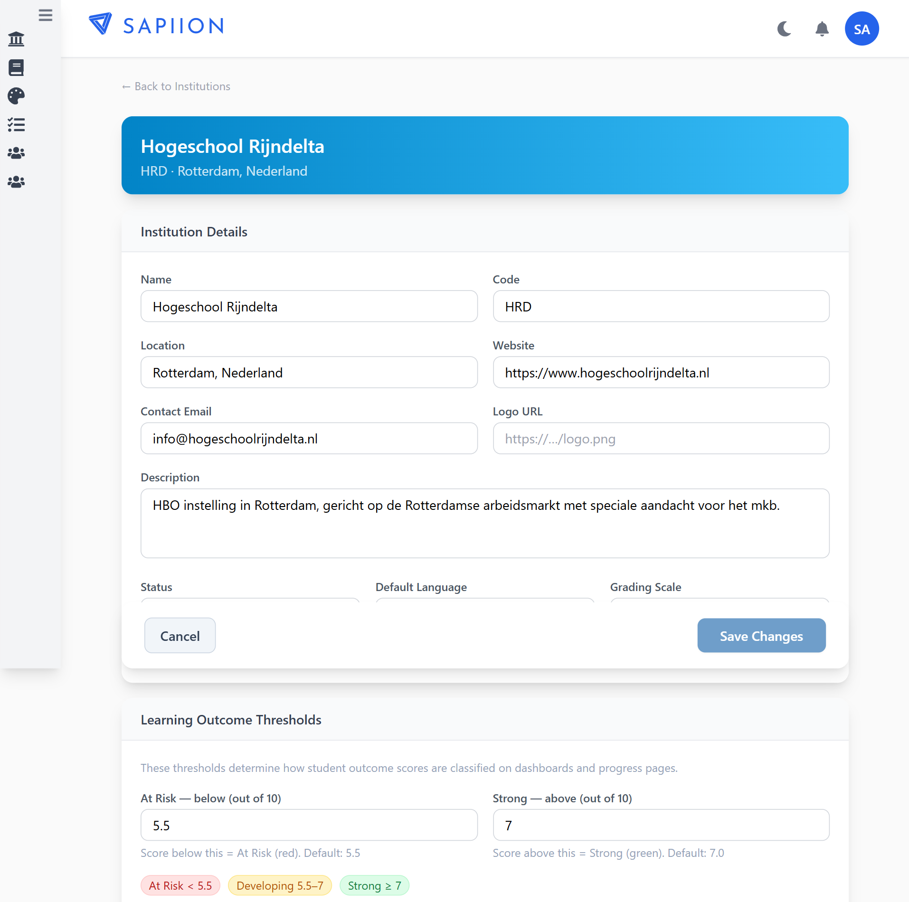
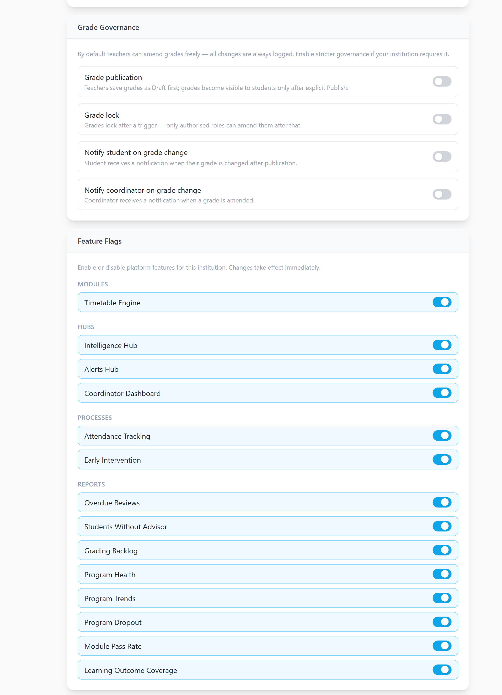
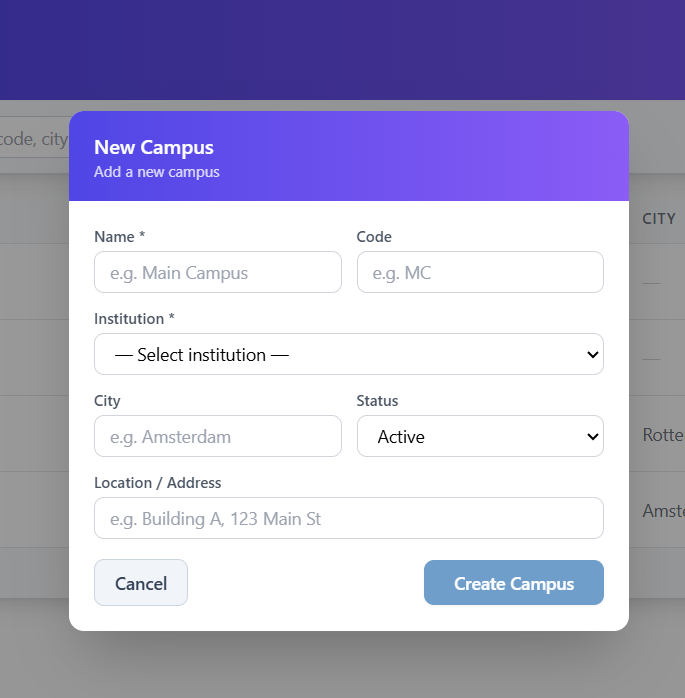
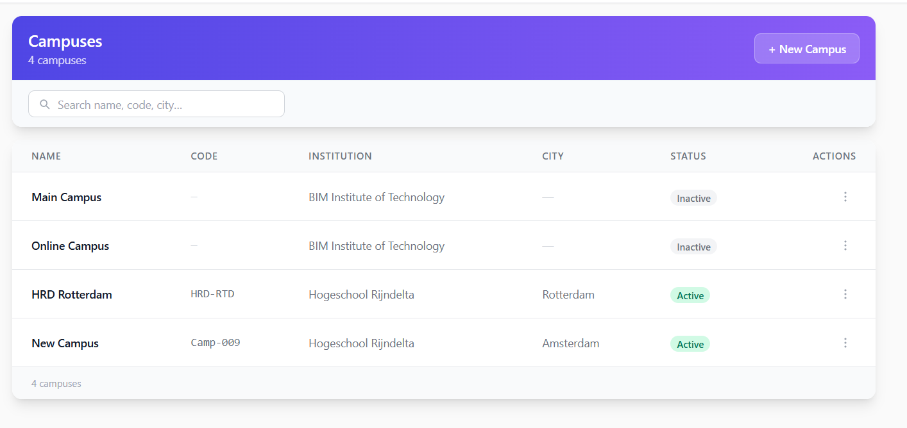
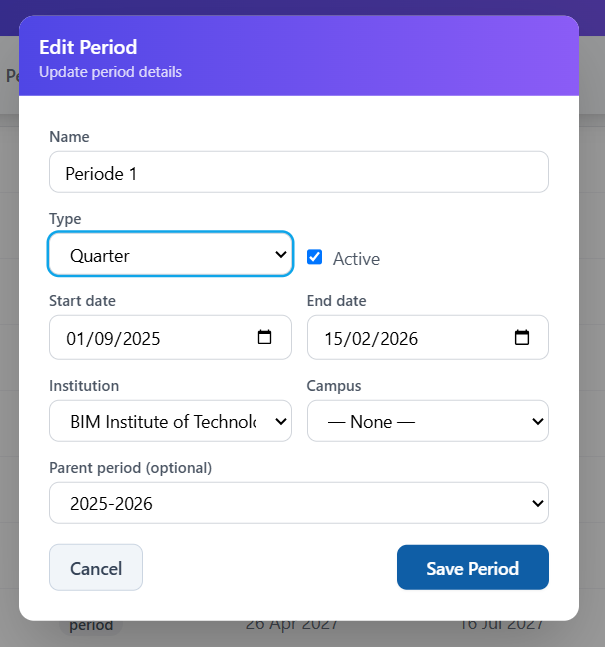
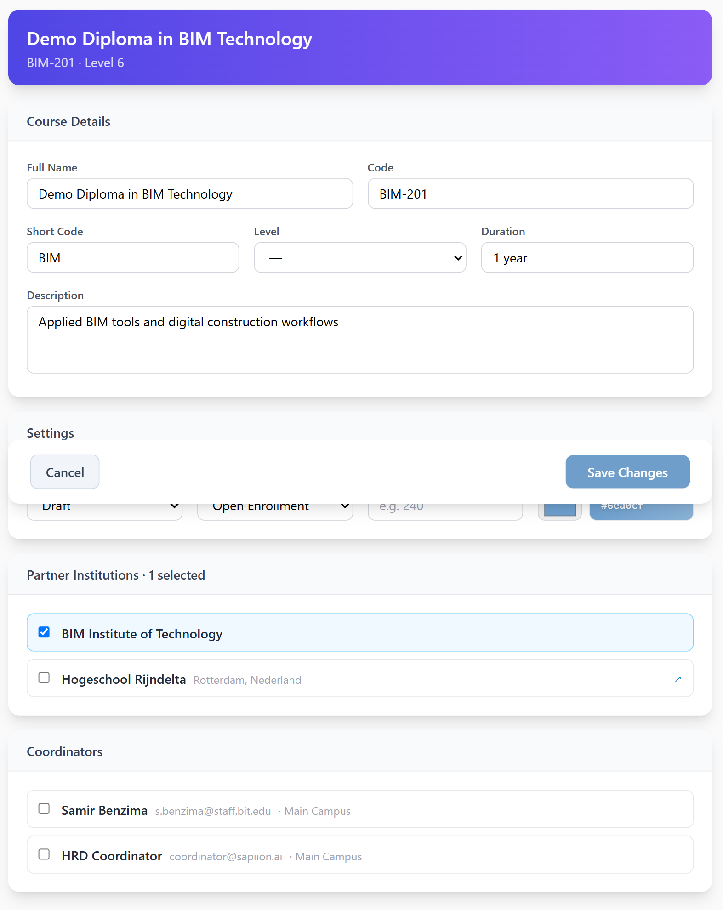
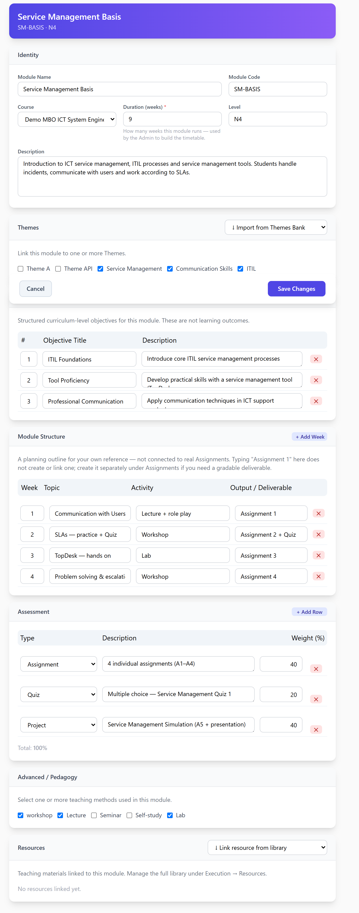

# ILS — End-to-End Setup Guide

This guide provides a complete workflow for setting up a new academic year, course, and curriculum. Intended for Admins, Curriculum Designers, and Teachers.

## Phase 1 — One-time Setup (Admin)

### Step 1 — Create an Institution
- Go to: **Institutions** → New
- Required: **Name** only — every other field is optional and can be filled in later from the institution's edit page
- Fields on the form: Name, Code, Location (free text, e.g. "Amsterdam" — not a country selector), Website, Contact Email, Logo URL, Description
- Also on this form: **Status** (Active/Inactive), **Default Language** (UI language for all users at this institution — English, Nederlands, Deutsch, Français, Español), **Grading Scale** (10/20/100 — internal scores always stay 0–100, this only controls display), and **Learning Outcome Thresholds** (At Risk / Strong cutoffs used to color-code student outcome scores on dashboards — defaults 5.5 and 7.0 out of 10)
- **Grade Governance** and **Feature Flags** sections only appear once the institution has been created (they're hidden on the New form) — set those up from the institution's edit page afterward

*(Example institution shown above uses fake demo data, not a real school.)*

### Step 2 — Create a Campus
- Go to: **Campuses** → New Campus (opens a modal, not a separate page)
- Required: **Name** and **Institution** (dropdown — pick the institution created in Step 1)
- Also on the form: Code, City, Status (Active/Inactive), Location

> **Joint-venture / partner-school institutions:** a Campus's Name doesn't have to match its owning Institution's name. If your school is a joint entity operating out of buildings belonging to one or more partner organizations, it's normal for a campus to be named after the *building's* owning partner (e.g. "Partner School - Campus North") while the Institution it belongs to in ILS is still your own school. Name the campus after the physical location, not the institution. Create one Campus per physical teaching location your classes actually use — a class links to exactly one campus, and which location(s) a class uses can change year to year (e.g. a class that used to be taught at a shared building might move fully to a partner's own building the next year).

### Step 3 — Create Academic Periods
- Go to: **Periods** → New Period
- Required: **Name** only. Valid **Type** values: Year, Semester, Block, Quarter, Custom
- Also on the form: Active (checkbox), Start/End Date, Institution (or "— Global —" to share across every institution on the platform — leave this as your own institution on a single-school install), Campus (leave "— None —" unless a specific building genuinely has a different calendar than the rest of your school), Parent Period
- **Create the top-level academic year first** (type **Year**, no parent, dates spanning the full school year), **then** its child periods underneath it (Parent Period = the Year record). The Year record isn't just organizational — the student-facing schedule page specifically looks up a period's parent to label its "Academic Year" heading; without it, that heading falls back to something less meaningful.
- Match **Type** to how many periods you actually run per year: a school with 2 half-year terms uses **Semester**; a school with 4 uses **Quarter** ("Semester" would be a term mismatch for 4 divisions of one year). Example: Academic Year 2026-2027 (type Year) → Periode 1, Periode 2, Periode 3, Periode 4 (type Quarter, each a child of the Year record)
- If both a Year and its children are scoped to the same Institution (not Global), a class at any campus under that institution can still use them — the class-creation period dropdown isn't filtered by campus, so one shared set of periods works for every campus in your school as long as they follow the same calendar
- **"School weeks" is not currently settable anywhere in the admin UI**, despite being used by the student schedule page (it falls back to computing period width from module data when unset) — this is an open question, not yet resolved one way or the other (see project tracking)

## Phase 2 — Build the Course

### Step 4 — Create a Course
- Go to: **Courses** → New Course
- Required: **Full Name** only — everything else is optional
- Fields on the form: Full Name, Code, Short Code, Level (dropdown — MBO 1-4, HBO, Associate Degree, or your institution's own configured levels), Duration, Description, Status (Draft/Published/Archived), Enrollment Type (Open Enrollment/Invite Only), Credits, Course Color
- Consider leaving **Status** on Draft until the course actually has Modules/Assignments built out (Steps 5-6), then switch to Published when it's ready for real use
- **Enrollment Type currently has no effect on anything** — there's no self-service signup flow yet (enrollment is always admin-driven, see Step 13), so this field is stored but not acted on anywhere in the app. Safe to leave on the default (Open Enrollment) regardless of how your program actually works.
- **Institutions:** a checkbox list of every institution on the platform — there's no separate "primary" vs "partner" distinction in the UI, it's one flat multi-select. For a course delivered solely by your own school, check only your own institution. For a genuinely joint program (see the Campus note above), check your own institution **and** the partner's — you'll need the partner created as its own (lightweight) Institution record first for it to appear in this list.
- **Coordinators:** a checkbox list of users with the Coordinator role, to assign programme-level oversight of this course
- Save

### Step 5 — Create Modules
- Go to: **Modules** → New Module
- Required: **Module Name** and **Duration (weeks)** (labeled "Duration (weeks)" on the form; stored internally as `planned_weeks`) — the form blocks Save with an alert if Duration is empty
- Also on the form: Module Code, Course, Level, Description
- **Duration (weeks) is critical** — this drives the Gantt bar width in the student's Schedule tab. It's the only module field with real downstream effect on the student view.
- Repeat for every module in the course

Everything below the Identity section is genuinely useful for planning and communication among staff, but **none of it reaches the student view today** — only the module's Name, Code, and its real Assignments/Quizzes (created separately, see Step 6) do:
- **Themes:** select existing Themes from the dropdown/checklist — this only *links* Themes already created elsewhere (Admin → Themes); there's no way to create a new Theme from inside this form
- **Module Objectives:** curriculum-design intent ("what this module is meant to teach") — explicitly not the same thing as the platform's real, measured Learning Outcomes
- **Module Structure:** a free-text weekly planning outline (Week / Topic / Activity / Output-Deliverable) for your own reference. It is **not connected to real Assignments** — typing "Assignment 1" in the Output column doesn't create or link one; create a real gradable Assignment separately (Step 6) if you need one
- **Assessment:** a descriptive breakdown (Type / Description / Weight %) for communicating how a module is graded — it does **not** feed any actual grade calculation anywhere in the platform today
- **Advanced/Pedagogy:** which teaching methods (Lecture, Workshop, Lab, etc.) this module uses — descriptive only
- **Resources:** links teaching materials from the shared library to this module; these reach students through individual Sessions, a separate, more granular concept, not directly from this list

*(Example module shown above uses demo data, not real coursework.)*

### Step 6 — Create Assignments (for each module)
- Go to: either the module's own **Assignments** sub-page → New Assignment (the module link is filled in for you), or **Admin → Assignments → New Assignment** (a generic form where you pick the Course, then the **Origin Module** from a dropdown — this is the real link between an Assignment and a Module; see the Module Structure note in Step 5)
- Required: **Title** and **Discipline** (free text, with autocomplete suggestions from disciplines already used elsewhere — not a fixed list, you can type a new one)
- Status: a Draft/Published toggle at the top — students only see Published assignments
- **Details:** Title, Discipline, Course, Origin Module, Description, Objectives, Instructions, Case Study
- **Grading:** Points, Assignment Group (a category label, e.g. "Weekly Assignments"), Display Grade As (Points/Percentage/Letter Grade), and **Rubric** — attach one or more real rubrics here if grading criteria are needed
- **Submission:** Due Date, Available From/Until, allowed entry types (Text Entry, Website URL, Media Recordings, Student Annotation, File Uploads — pick one or more), submission attempts
- **Collaboration & Peer Review:** optionally mark as a group assignment (grading applies to the whole team), or require peer reviews between students
- **Resources:** link teaching materials from the shared library — same pattern as a Module's own Resources section
- **Reflection** (optional): questions a student answers after submitting — a separate system from Teaching Feedback, never merge the two

### Step 7 — Create Quizzes (for each module, optional)
- Go to: **Quizzes** → New Quiz
- Add questions: MCQ (set correct answer!) or Open/Essay
- MCQ quizzes auto-grade on submit — only works if correct answer is set on every question

## Phase 3 — Design the Curriculum

### Step 8 — Open the Curriculum Composer
- Go to: **Curriculum Composer** → select the course

### Step 9 — Build the Period Structure (Step 2 in Composer)
- Create the hierarchy: Year-1 → Period-1, Period-2, Period-3, Period-4
- The period names must match the calendar periods exactly (e.g., "Period-1") so scheduling syncs correctly
- Or apply a template if one exists

### Step 10 — Assign Modules to Periods (Step 3 in Composer)
- Drag modules from the library into the correct period
- Set Start Week (week within that period, 1 = first school week)
- The "Also assign to active classes?" checkbox is checked by default — leave it checked if the class already exists, uncheck if you want to assign manually later
- Modules from other courses can be added here (cross-course sharing)

## Phase 4 — Set Up the Class

### Step 11 — Create a Class
- Go to: **Classes** → New Class (or use Step 4 inside the Curriculum Composer)
- Fields: Name (e.g., WIL-ISE1A - Year-1 BOL4), Code, Period (link to the academic year period), Campus, Enrollment Type
- Link to Course

### Step 12 — Assign Modules to the Class
- Go to: **My Classes** → [class name] (Teacher Class page)
- The curriculum blueprint suggests modules from the course structure
- Add modules one by one or accept suggestions
- Assign a teacher to each module
- Save
- **Note:** If you used the "Also assign to active classes?" checkbox in Step 10, modules are already here. This step is for review and teacher assignment only.

### Step 13 — Enroll Students
- Go to: **Classes** → [class name] (Class Detail page)
- In the Students panel, search for students by name or student number
- Select them and click Enroll N selected
- Set Enrollment Type per student if needed (BOL, BBL, etc.)
- Save Changes

## Phase 5 — Student Experience

### What the student sees after login:

#### Curriculum Tab
- Select their course from the dropdown
- Modules grouped by Academic Year → Period (collapsible)
- Each module shows its assignments with submission status and scores
- Quiz scores shown as X.X / 10

#### Schedule Tab
- Gantt chart grouped by Academic Year → Period
- Each period shows exactly its school weeks (not more)
- Modules shown as colored bars starting at their week_from
- If a module overflows into the next period, it shows › in the first period and ‹ continued in the next
- Clicking a bar jumps to that module in the Curriculum tab

---

## Key Rules to Remember

| Rule | Why |
|------|-----|
| course_structure = pedagogy layer | What the designer planned |
| course_timeline = scheduling layer | When it actually runs |
| class_modules = delivery layer | What each class teaches |
| These three are NOT auto-synced | Each class can deviate from the curriculum design |
| planned_weeks on the module | Controls Gantt bar width |
| school_weeks on the period | Controls Gantt column count |
| correct_answer must be set on MCQ questions | Otherwise quiz auto-grades as 0 |
| Removing a module from the Composer removes it from the student view | But NOT from class_modules — the class still "has" the module |

---

# Session Summary — 2026-05-28 (Technical/Developer Reference)

## Bug Fixes
- Quiz grading page now shows all quizzes; MCQ-only quizzes are labeled “Auto-graded.”
- Fixed duplicate students in grading (now only latest submission per student is shown).
- Quiz scores in student curriculum now display correctly (shows latest attempt per module item).

## Major Architecture: `course_timeline` (Migration 0075)
- **course_structure**: Pedagogy (Composer UI — module ordering, grouping, hierarchy)
- **course_timeline**: Scheduling (when modules run — academic_period_id, study_year, week_from)
- Added `school_weeks` to `academic_periods`.
- Created 4 real calendar periods under Academic Year 2026-2027 with Dutch academic calendar dates.
- Populated `course_timeline` from existing curriculum data.

## Student Schedule Tab — Full Rebuild
- Academic years are collapsible headers.
- Each period shows only its own school weeks.
- Modules spanning periods are visually continued (›/‹ bars).
- Empty periods are shown for overflow display.

## Curriculum Composer → `course_timeline` Sync
- All Composer changes (move, delete) update `course_timeline`.
- Removing a module from Composer removes it from the student view.

## Cross-Course Module Sharing
- Modules from other courses can be added to a curriculum via the Composer.
- “Also assign to active classes?” checkbox: checked = assign to all active classes, unchecked = design only.

## Architecture Decision: Three-Layer Delivery Model
- **Design**: `course_structure` / `course_timeline` (curriculum designer)
- **Offer**: `course_module_offerings` (future, Phase 4+)
- **Deliver**: `class_modules` (what each class actually teaches)
- The “assign to active classes” checkbox is a temporary bridge; future versions will use `course_module_offerings` for flexible delivery.

**Last updated:** 2026-07-08
