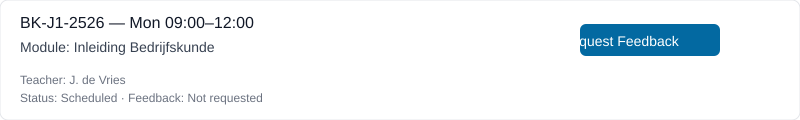
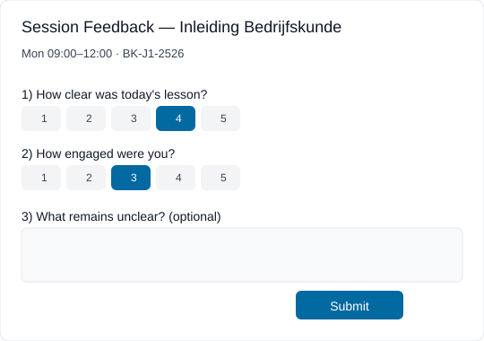

# Session Feedback — UI mockup

This mockup shows a lightweight session feedback flow for teachers and students. Read-only: it's documentation only; `ILS-dev` will not be changed.

## Teacher view (session card)

Session: BK-J1-2526 — Mon 09:00–12:00 — Module: Inleiding Bedrijfskunde

- [Request Feedback]

When teacher clicks `Request Feedback`, the system:

1. Marks the session as `feedback_requested`.
2. Sends a short prompt to enrolled students (in-app + email/SMS optionally).

## Student view (mobile-friendly)

Card:

Session: Mon 09:00–12:00 — Inleiding Bedrijfskunde

How clear was today's lesson?

How engaged were you?

What remains unclear? (optional)

_Free text input_

[Submit]

## Quick analytics (teacher/coordinator)

## Visual mockups

Teacher session card (click `Request Feedback`):

Student modal (mobile-friendly):

## Minimal API sketch (docs-only)

- POST `/api/feedback/session/:sessionId/request` — mark session feedback requested and enqueue notifications
- POST `/api/feedback/session/:sessionId/response` — body: `{ student_id, clarity_score, engagement_score, comments }`
- GET `/api/feedback/session/:sessionId/summary` — returns aggregated metrics and sample comments

**Last updated:** 2026-07-08
